# LunaMic – Downloads

LunaMic filtert dein Mikrofon (Noise Gate, Kompressor, EQ, De-Esser …) und
gibt es als virtuelles Mikrofon „LunaMic“ an Discord, OBS, Spiele und den
Browser weiter. Für Windows und Linux (PipeWire).

Hier liegen nur die fertigen Programmdateien.

## So sieht es aus

| Übersicht | Filter | Equalizer |
|---|---|---|
| 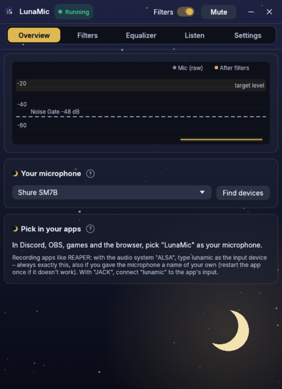 | 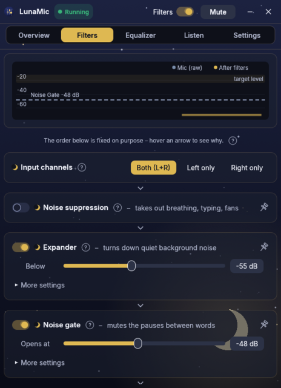 | 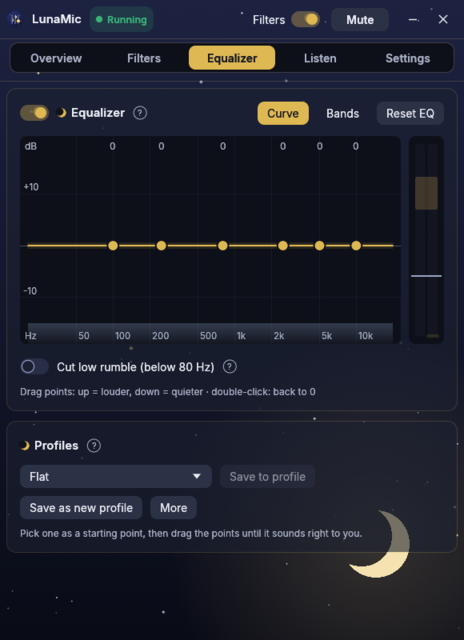 |
| Pegel vorher/nachher, dein Mikro, wo du LunaMic in Discord, OBS & Co. auswählst. | Jeder Filter mit An/Aus und einem Regler, in einfachen Worten erklärt. | Kurve zum Ziehen oder Bänder, mit Profilen. |

| Feinwerte | Hören & testen | Einstellungen |
|---|---|---|
| 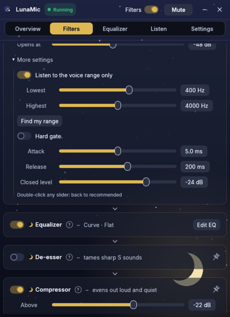 | 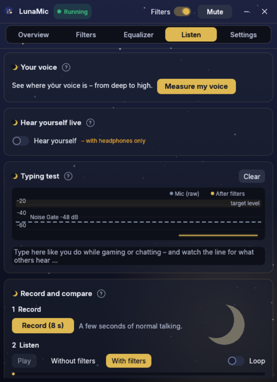 | 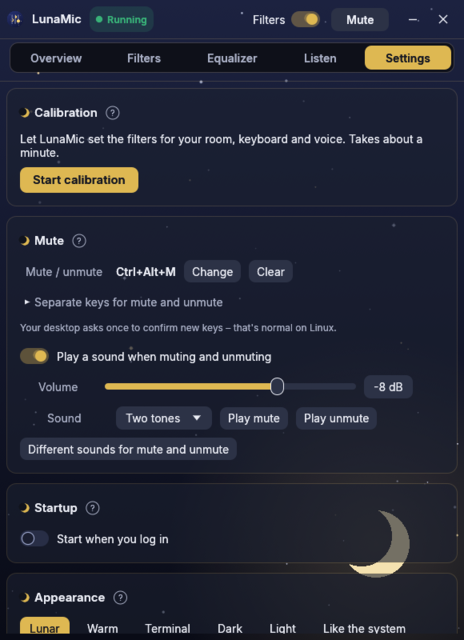 |
| Mehr Einstellungen klappen erst auf, wenn du sie brauchst. | Sich selbst hören, Tipp-Test, aufnehmen und vergleichen – mit und ohne Filter. | Einmessen, Stummschalten per Tastenkürzel, Autostart, Aussehen, Updates. |

| Willkommen | Einrichtungs-Assistent |
|---|---|
| 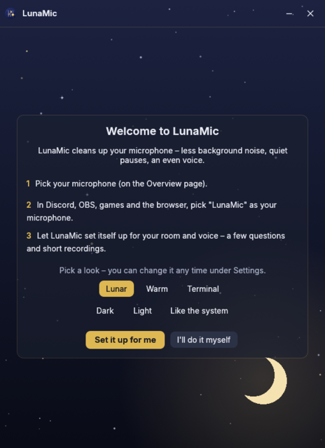 | 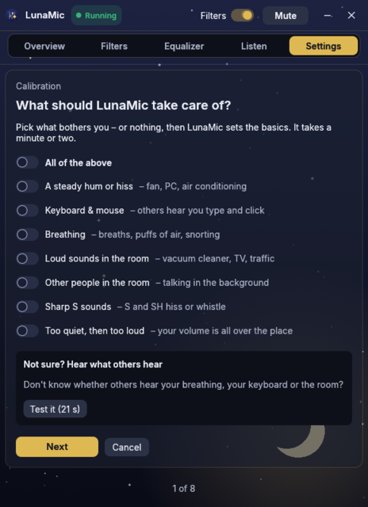 |
| Beim ersten Start in drei Schritten erklärt. | Sag, was stört (Tastatur, Lüfter, Atmen …) – LunaMic misst und stellt sich selbst ein. |

**Fünf Looks:** Lunar (Standard), Dark, Light, Warm und Terminal.

| Dark | Light | Warm | Terminal |
|---|---|---|---|
| 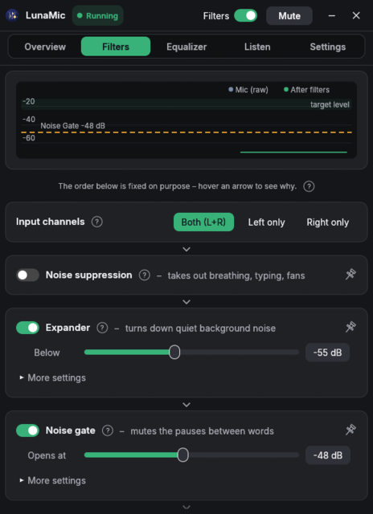 | 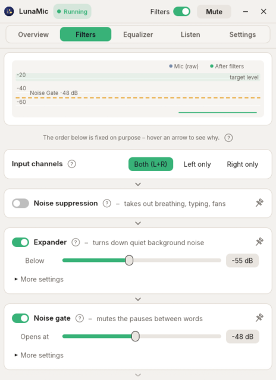 | 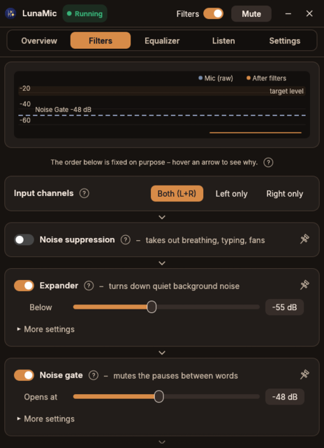 | 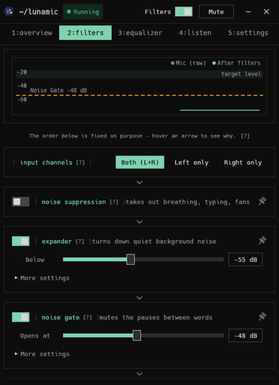 |

## Herunterladen

**[Neueste Version](https://github.com/Sajovara/LunaMic-releases/releases/latest)**

- Windows: `LunaMic-windows.zip` – entpacken, `LunaMic.exe` in einen eigenen
  Ordner legen (z. B. `Dokumente\LunaMic`, **nicht** `C:\Programme`) und starten.
  Die Anleitung steht in `LIESMICH-Windows.txt`.
- Linux: `LunaMic-linux.tar.gz` – entpacken und `./LunaMic` starten.
  Anleitung in `LIESMICH-Linux.txt`.

## Aktualisieren

Am einfachsten in LunaMic selbst: **Settings → Updates → Update now**.
LunaMic schaut auch von allein nach. Einstellungen bleiben erhalten.

Oder im Terminal (beendet LunaMic, lädt die neue Version an dieselbe Stelle
und startet sie):

**Windows (PowerShell)**
```powershell
$p=(Get-Process LunaMic -EA 0).Path; if(!$p){$p="$env:USERPROFILE\Documents\LunaMic\LunaMic.exe"; ni -Force -ItemType Directory (Split-Path $p) | Out-Null}; Stop-Process -Name LunaMic -EA 0; sleep 2; iwr https://github.com/Sajovara/LunaMic-releases/releases/latest/download/LunaMic.exe -OutFile $p; start $p
```

**Linux**
```sh
p=$(readlink -f /proc/$(pgrep -x LunaMic)/exe 2>/dev/null || echo ~/Programme/LunaMic/LunaMic); p=${p% (deleted)}; mkdir -p "$(dirname "$p")"; pkill -x LunaMic; sleep 2; curl -fL -o "$p.new" https://github.com/Sajovara/LunaMic-releases/releases/latest/download/LunaMic-linux && chmod +x "$p.new" && mv "$p.new" "$p" && setsid -f "$p"
```

## Gut zu wissen

- Windows warnt beim ersten Start evtl. vor einem „unbekannten Herausgeber“,
  weil die Datei nicht signiert ist: „Weitere Informationen“ → „Trotzdem ausführen“.
- `SHA256SUMS` enthält die Prüfsummen; LunaMics eigener Updater prüft sie.
- Das virtuelle Mikrofon unter Windows ist VB-CABLE von VB-Audio
  (Spendenware, https://vb-audio.com/Cable/), in LunaMic enthalten.
