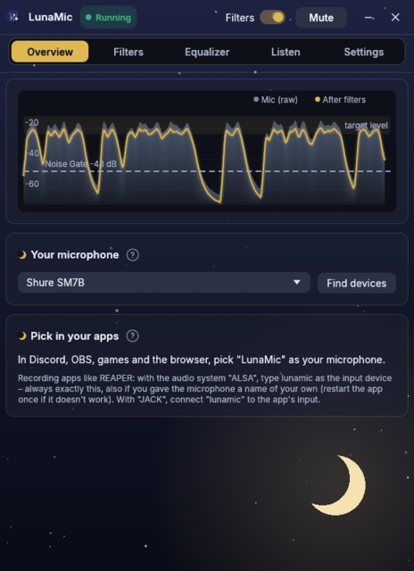

<h1 align="center">LunaMic</h1>

<p align="center">
  <b>Dein Mikrofon, aufgeräumt.</b><br>
  Noise Gate, Kompressor, EQ, De-Esser & Co. – als virtuelles Mikrofon „LunaMic“<br>
  für Discord, OBS, Spiele und den Browser. Für <b>Windows</b> und <b>Linux</b> (PipeWire).
</p>

<p align="center">
  <a href="https://github.com/Sajovara/LunaMic-releases/releases/latest"><b>⬇ Neueste Version herunterladen</b></a>
</p>

Hier liegen nur die fertigen Programmdateien.

## Was es kann

- **Weniger Störgeräusche** – Rauschunterdrückung, Expander und Noise Gate machen
  Lüfter, Tastatur und Atmen in den Sprechpausen leise.
- **Gleichmäßige Lautstärke** – Kompressor und Limiter fangen zu leise und zu laut ab.
- **Klang nach Geschmack** – Equalizer zum Ziehen und De-Esser gegen scharfe S-Laute.
- **Einfach zu bedienen** – jeder Filter hat An/Aus und einen Regler, alles in
  einfachen Worten erklärt. Der Einrichtungs-Assistent stellt alles selbst ein.
- **Klein und schlank** – eine Datei, kein Installer, Stummschalten per Tastenkürzel,
  Symbol im Tray.

## So sieht es aus

### Übersicht

Pegel vorher und nachher, dein Mikrofon und wo du LunaMic in Discord, OBS & Co. auswählst.

<p align="center"></p>

### Filter

Jeder Filter mit An/Aus und einem Regler, in einfachen Worten erklärt.

<p align="center"></p>

Feinwerte klappen erst auf, wenn du sie brauchst.

<p align="center"></p>

### Equalizer

Kurve zum Ziehen oder einzelne Bänder, dahinter siehst du live, wie laut welcher
Bereich gerade ist. Mit Profilen zum Speichern.

<p align="center"></p>

### Hören & testen

Sich selbst hören, Tipp-Test, aufnehmen und vergleichen – mit und ohne Filter.

<p align="center"></p>

### Einrichtungs-Assistent

Sag, was stört (Tastatur, Lüfter, Atmen …) – LunaMic misst und stellt sich selbst ein.

<p align="center"></p>

### Einstellungen

Einmessen, Stummschalten per Tastenkürzel, Autostart, Aussehen, Updates.

<p align="center"></p>

### Willkommen

Beim ersten Start in drei Schritten erklärt.

<p align="center"></p>

### Fünf Looks

Dark (oben, mit sieben Akzentfarben), Lunar (Standard), Light, Warm und Terminal.

<details>
<summary><b>Die anderen Looks ansehen</b></summary>

#### Lunar

<p align="center"></p>

#### Light

<p align="center"></p>

#### Warm

<p align="center"></p>

#### Terminal

<p align="center"></p>

</details>

## Herunterladen

**[Neueste Version](https://github.com/Sajovara/LunaMic-releases/releases/latest)**

- Windows: `LunaMic-windows.zip` – entpacken, `LunaMic.exe` in einen eigenen
  Ordner legen (z. B. `Dokumente\LunaMic`, **nicht** `C:\Programme`) und starten.
  Die Anleitung steht in `LIESMICH-Windows.txt`.
- Linux: `LunaMic-linux.tar.gz` – entpacken und `./LunaMic` starten.
  Anleitung in `LIESMICH-Linux.txt`.

## Aktualisieren

Am einfachsten in LunaMic selbst: **Settings → Updates → Update now**.
LunaMic schaut auch von allein nach. Einstellungen bleiben erhalten.

Oder im Terminal (beendet LunaMic, lädt die neue Version an dieselbe Stelle
und startet sie):

**Windows (PowerShell)**
```powershell
$p=(Get-Process LunaMic -EA 0).Path; if(!$p){$p="$env:USERPROFILE\Documents\LunaMic\LunaMic.exe"; ni -Force -ItemType Directory (Split-Path $p) | Out-Null}; Stop-Process -Name LunaMic -EA 0; sleep 2; iwr https://github.com/Sajovara/LunaMic-releases/releases/latest/download/LunaMic.exe -OutFile $p; start $p
```

**Linux**
```sh
p=$(readlink -f /proc/$(pgrep -x LunaMic)/exe 2>/dev/null || echo ~/Programme/LunaMic/LunaMic); p=${p% (deleted)}; mkdir -p "$(dirname "$p")"; pkill -x LunaMic; sleep 2; curl -fL -o "$p.new" https://github.com/Sajovara/LunaMic-releases/releases/latest/download/LunaMic-linux && chmod +x "$p.new" && mv "$p.new" "$p" && setsid -f "$p"
```

## Gut zu wissen

- Windows warnt beim ersten Start evtl. vor einem „unbekannten Herausgeber“,
  weil die Datei nicht signiert ist: „Weitere Informationen“ → „Trotzdem ausführen“.
- `SHA256SUMS` enthält die Prüfsummen; LunaMics eigener Updater prüft sie.
- Das virtuelle Mikrofon unter Windows ist VB-CABLE von VB-Audio
  (Spendenware, https://vb-audio.com/Cable/), in LunaMic enthalten.
